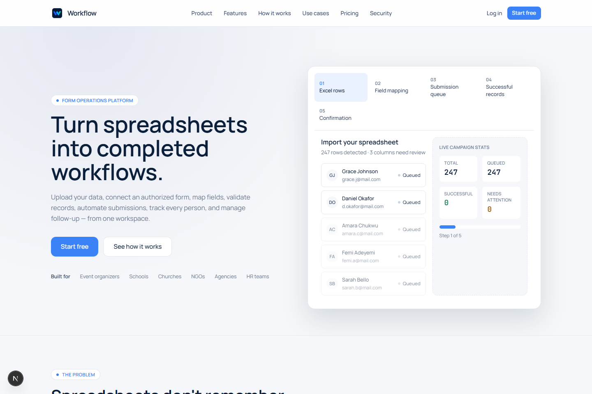
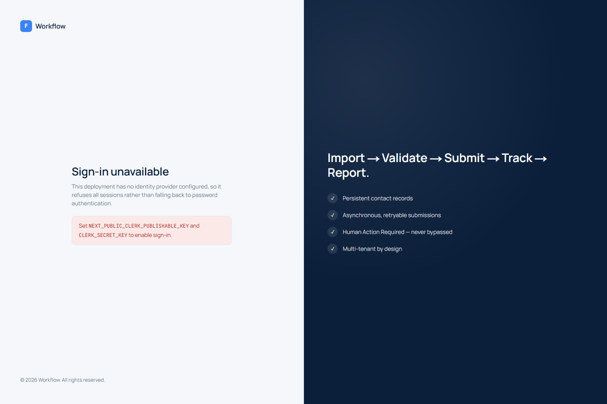
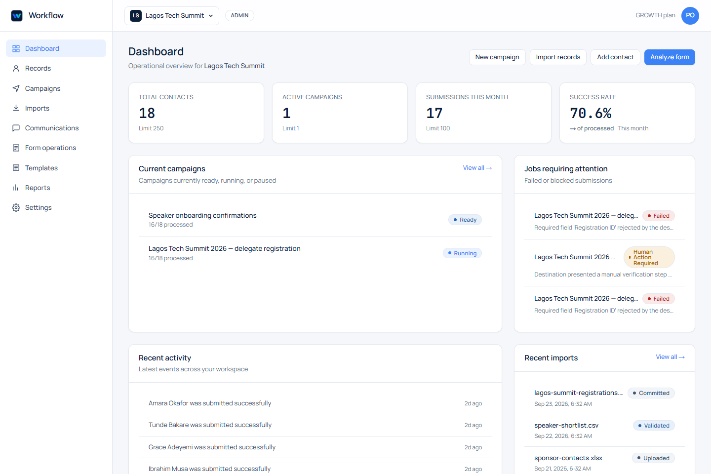
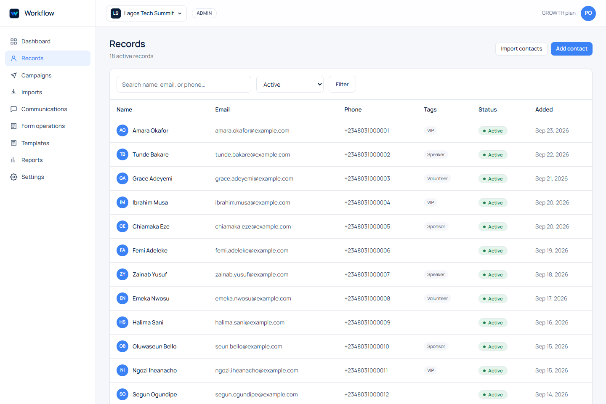
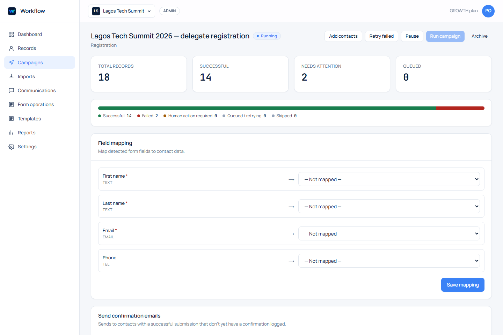
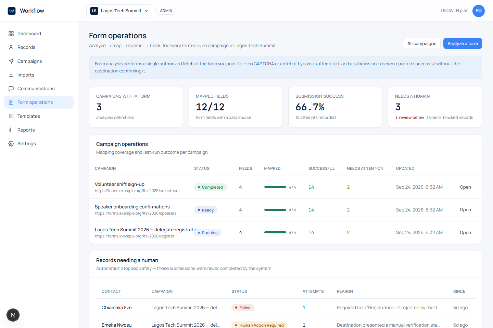
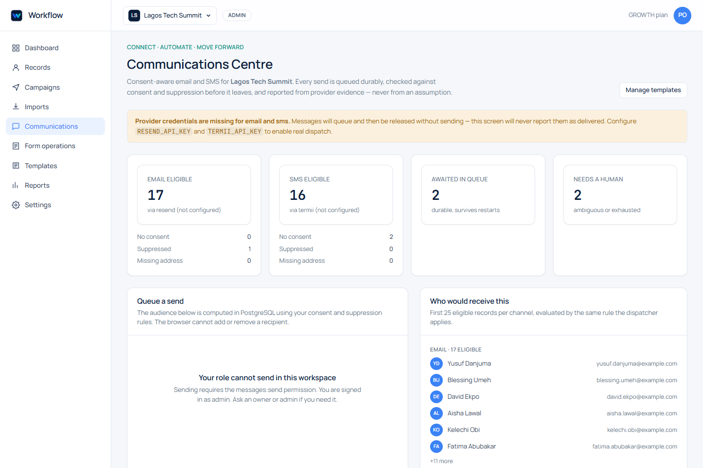
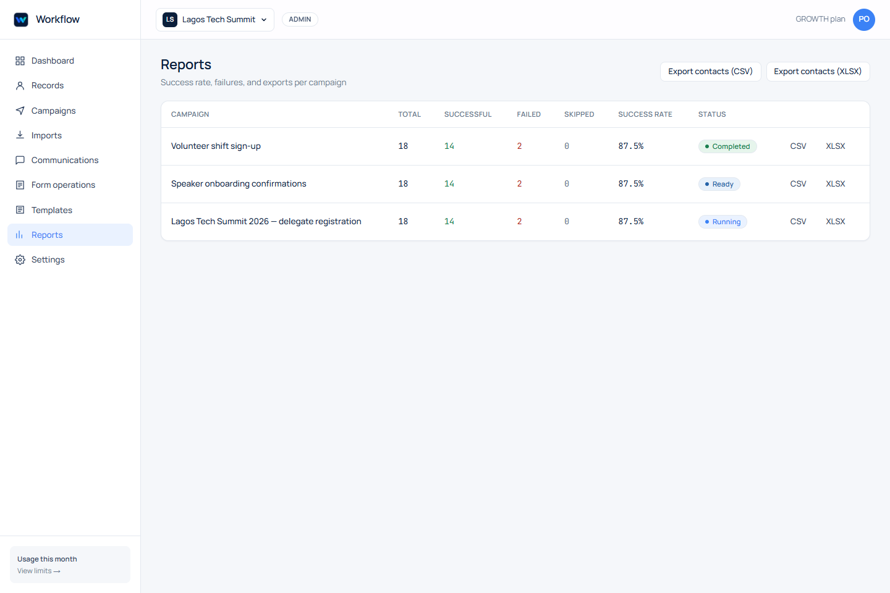
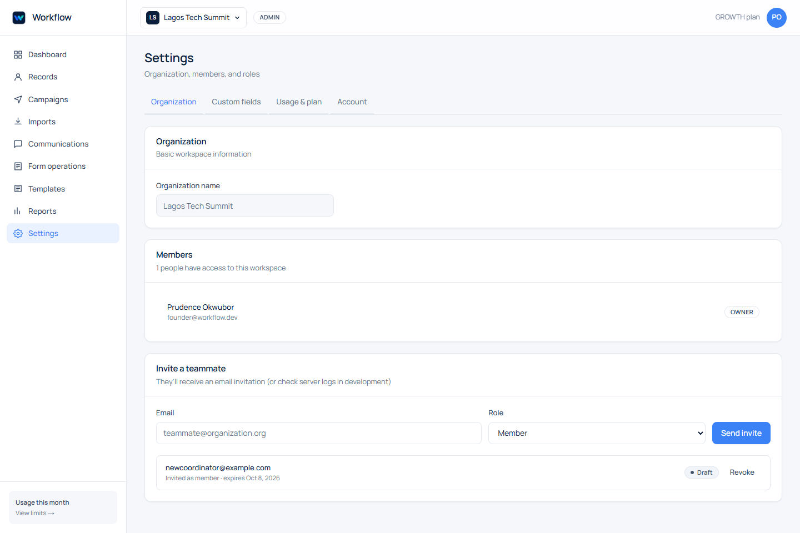
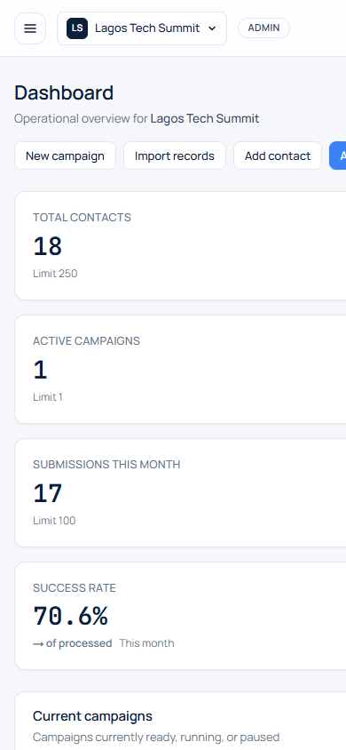

# Workflow

**All your operations. In flow.**

Workflow is a multi-tenant operations workspace: import records, run campaigns,
communicate over email/SMS, operate public forms, and report on outcomes — with
tenant isolation enforced by PostgreSQL row level security rather than by
remembering to add `where org_id = ...` to every query.

> **Status: development / testing branch.** This repository is being built and
> verified against a Neon **development** branch. It has not been deployed to
> production, has no production data, and no real bulk communications have been
> sent. See [What works today](#what-works-today-verified) and
> [Not wired yet](#not-wired-yet) for the exact line between the two.

---

## Screenshots

Every image below is captured from the running application by
`scripts/screenshots.mjs`, which signs in through the real login form and walks
the real routes — so the screenshots cannot drift from the shipped UI. The full
set (19 images, desktop + mobile) lives in [`docs/screenshots/`](docs/screenshots).

| | |
|---|---|
|  |  |
| **Public site** | **Sign in** |
|  |  |
| **Dashboard** | **Records** |
|  |  |
| **Campaign detail** | **Form operations** |
|  |  |
| **Communications center** | **Reports** |
|  |  |
| **Workspace settings** | **Dashboard (mobile)** |

---

## Stack

- **Next.js 16.3.6** (App Router, Turbopack, React 19, Server Actions)
- **PostgreSQL** on Neon, one database, org-scoped tables + RLS
- **Drizzle ORM** 0.45 with SQL migration files and a deterministic runner
- **Tailwind CSS 4**, Manrope + JetBrains Mono, brand palette
  `#0B1F3B` / `#3B82F6` / `#14B8A6` / `#FFFFFF`
- **Clerk** (`@clerk/nextjs` installed, identity bridge in `src/lib/auth.ts`)
- **Resend** (email) and **Termii** (SMS) behind a durable outbox
- **Cloudflare R2** for uploaded bytes (Cloudinary stays for images only)
- **Vitest** suites that run against a real database

---

## Quick start

Prerequisites: **Node 22** and npm.

```bash
npm install

# 1. Environment — copy the template and fill in a Neon connection string.
cp .env.example .env.local
#   DATABASE_URL=            # pooled endpoint (contains "-pooler")
#   DATABASE_URL_UNPOOLED=   # direct endpoint, used by migrations
#   NEXT_PUBLIC_APP_URL=http://localhost:3000

# 2. Schema (development branch only)
npm run db:generate        # author a migration from schema changes (if any)
npm run db:migrate         # drizzle-kit migrate
# or the deterministic runner used in CI-style flows:
node scripts/db-migrate.mjs

# 3. Optional demo data (refuses to run outside NEON_BRANCH=development)
NEON_BRANCH=development node scripts/seed-demo.mjs

# 4. Run
npm run dev                # http://localhost:3000
npm run typecheck          # tsc --noEmit
npm test                   # vitest, needs a real database
```

Seeded demo login: `founder@workflow.dev` / `Workflow2026!`, with two
organizations (one owner, one viewer) to exercise workspace switching.

### Windows / WSL build caveat (important)

If the production build fails with `Invariant: Expected workStore to be
initialized` while prerendering `/_not-found`, the cause is almost certainly the
**casing of your working directory**, not your code. Node keys modules by path
string, so building from `C:\Users\You\Desktop\my-app` when the folder on disk is
`desktop` loads `next` twice and loses its render context. Build from the exact
on-disk casing:

```powershell
Set-Location "C:\Users\You\desktop\my-app"   # match the real folder case
npx next build
```

Run `node scripts/screenshots.mjs` with the dev server URL to refresh
`docs/screenshots/` after UI changes.

---

## What works today (verified)

Confirmed on this development branch, with the commands noted:

- **Type checking** — `npx tsc --noEmit` passes (exit 0).
- **Production build** — `npx next build` passes; all routes compile and
  `/_not-found` prerenders (from the correctly-cased path).
- **Test suite** — `npm test` → **4 files, 41 tests passed** against real
  PostgreSQL:
  - `tenant-isolation.test.ts` (20) — RLS, forged/absent context, cross-tenant
    reads and writes, last-owner protection, privilege self-escalation,
    worker-role limits, platform-admin allowlist
  - `outbox-idempotency.test.ts` (5) — duplicate keys, single claim, backoff,
    max-attempt exhaustion, ambiguous outcomes never auto-retried
  - `webhook-signature.test.ts` (11) — Resend/Termii signature verification
  - `telegram-allowlist.test.ts` (5) — fail-closed chat allowlist
- **Running application** — `next dev`, `/api/health` returns `200`; all
  customer surfaces render: dashboard, records, record detail, campaigns,
  campaign detail, imports, imports detail, communications, form operations,
  templates, reports, workspace settings, usage, platform admin.
- **Tenant-scoped writes** — every customer mutation (contacts, notes, tags,
  custom fields, campaigns, campaign records, imports, templates, invitations,
  roles, membership, organization rename) runs as the restricted `workflow_app`
  role inside a transaction whose org context the database proved. A smoke pass
  exercised each write path successfully.
- **Cross-tenant HTTP isolation** — the tenant-isolation suite proves that a
  forged organisation context raises `42501`, that a non-member cannot enter a
  different tenant, and that a revoked membership loses access immediately.

## Not wired yet

These are designed and partially coded, but **not verified end to end** because
the local environment has no provider credentials:

- **Clerk keys.** `@clerk/nextjs` is installed, `src/proxy.ts` mounts
  `clerkMiddleware()` when keys exist, and `/login` + `/signup` render
  Clerk's hosted components (`routing="hash"`) in `clerk` mode with a
  fail-closed `unconfigured` mode in production. No test/production keys
  are configured yet, so development still uses the transitional password
  bridge. Setup + verification checklist: `docs/CLERK.md`.
- **Live email/SMS delivery.** The outbox, idempotency, consent/suppression and
  webhook verification are tested; actual Resend/Termii dispatch needs keys.
- **R2 storage.** The R2/SigV4 driver exists and refuses a silent local fallback
  in production; without R2 credentials, development uses the local driver.
- **Telegram ops bot.** `/status`, `/health`, `/usage`, `/failed` handlers and
  the fail-closed allowlist are tested; wiring a real bot token is pending.
- **Cloudflare Workers preview.** `wrangler.jsonc` is scaffolded
  (development vars only, secrets via `wrangler secret put`) and `src/db`
  selects an edge Neon transport when `DATABASE_RUNTIME=edge`
  (`tests/edge-driver.test.ts` proves tenant semantics hold). Remaining:
  dashboard secrets + the first real preview build
  (`docs/CLOUDFLARE-PREVIEW.md`).
  **Trigger.dev** scheduling is not integrated; the worker outbox route is
  ready to be driven by any cron/Trigger job (`docs/PROVIDERS.md`).

---

## Architecture

```
Browser ──► Next.js (App Router, RSC + Server Actions)
              │
              │  customer reads/writes ──► src/lib/data.ts  (the gateway)
              │                                 │
              │                                 ▼
              │                  withTenant(identity, orgId)
              │                    1. app.begin_*_session(verified identity)
              │                    2. app.set_tenant_context(orgId)  ─┐ 42501 if not a member
              │                    3. SET LOCAL ROLE workflow_app ────┘ no BYPASSRLS
              │                                 │
              ▼                                 ▼
        privileged paths                    PostgreSQL (RLS FORCE)
        (platform admin, invite             every tenant table policy:
         tokens, worker, webhooks)          org_id = app.current_org_id()
```

**Tenancy.** Every tenant table has `ENABLE` + `FORCE ROW LEVEL SECURITY` with a
policy `USING (scope = app.current_org_id()) WITH CHECK (...)`. The customer
runtime connects as `workflow_app`, which has `rolbypassrls = false`. A missing
filter yields fewer rows, not a leak. Organisation context is transaction-local
(`set_config(..., true)`), so a pooled connection can never carry one tenant's
context into the next request.

**The gateway.** Customer pages and actions never import `@/db`. They call
`src/lib/data.ts`, which exposes `inWorkspace(workspace, tx => ...)` and
typed query/mutation functions. The only privileged reads left are deliberate:
`platform-admin/page.tsx` (gated by the database allowlist) and
`invite/[token]/page.tsx` (the secret token is the authorisation, and the join
is performed by `app.accept_invitation`).

**Membership is enforced in the database.** Invitations, role changes and
membership status go through `SECURITY DEFINER` functions
(`app.create_invitation`, `app.accept_invitation`, `app.set_member_role`,
`app.set_member_status`) that re-check permission, forbid inviting as owner,
and refuse to leave a workspace ownerless — the application cannot weaken those
rules. Credential changes and invitation revocation, which the app role is
deliberately not granted, use the administrative connection with explicit
scoping.

**Communications.** Sends are queued, never echoed as sent. Consent and
suppression are evaluated inside the tenant transaction, and an outbox
idempotency key makes a retried request unable to double-send. Provider webhooks
are verified before they mutate anything, and an ambiguous provider outcome is
parked for a human instead of being auto-retried.

**Files.** Uploaded bytes go to object storage; only a storage key is recorded in
PostgreSQL. Cloudinary remains the image store.

---

## Routes

Public: `/`, `/pricing`, `/product`, `/about`, `/security`, `/how-it-works`,
`/use-cases`, `/contact`, `/privacy`, `/terms`, `/login`, `/signup`.

Workspace (`/`): `/dashboard`, `/contacts`, `/contacts/new`, `/contacts/[id]`,
`/campaigns`, `/campaigns/new`, `/campaigns/[id]`, `/campaigns/[id]/add-contacts`,
`/imports`, `/imports/new`, `/imports/[id]`, `/communications`, `/form-operations`,
`/templates`, `/reports`, `/settings/organization`, `/settings/fields`,
`/settings/usage`, `/settings/account`, `/platform-admin`, `/onboarding`,
`/invite/[token]`.

API: `/api/health`, `/api/exports/contacts`, `/api/exports/campaigns/[id]`,
`/api/worker/outbox`, `/api/webhooks/{resend,termii,telegram}`.

---

## Security model (what the tests actually assert)

- A forged or absent organisation context raises `42501`.
- A member cannot read or write another tenant's rows, even with a direct filter.
- Cross-tenant updates that would move a row between tenants are rejected.
- A stale session loses access the moment membership is revoked.
- Permissions resolve from the database, not from the request; a viewer stays
  read-only, and a profile update cannot set `is_platform_admin`.
- `platform_admins`, `webhook_events` and `sessions` are deny-all for the app
  role; the worker role gets the queue without unrelated customer tables.
- Platform administration is minted only for the allowlisted Clerk subject.

---

## Scripts

| Script | Purpose |
|---|---|
| `scripts/db-migrate.mjs` | Deterministic migration runner in journal order |
| `scripts/db-apply-sql.mjs` | Apply a single SQL file |
| `scripts/db-inspect.mjs` | Inspect schema/RLS state |
| `scripts/seed-demo.mjs` | Seed a development branch (refuses non-development) |
| `scripts/screenshots.mjs` | Sign in and capture `docs/screenshots/` |
| `scripts/http-security-check.mjs` | Cross-tenant HTTP isolation checks |

---

## License

Proprietary. All rights reserved. Not for redistribution.
